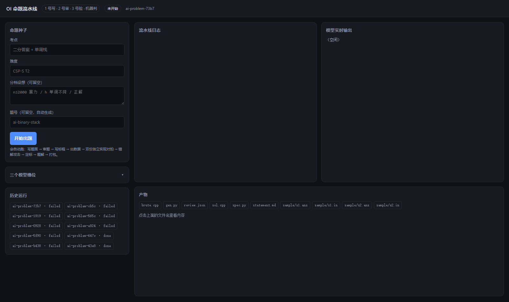

# 命题流水线 Web 系统

三个模型槽位 + 一条机器裁判的流水线。你只填「考点 / 难度」，剩下的交给 AI 写、机器判。

```bash
cd E:\oj工作区\oj
python web/server.py            # http://127.0.0.1:8770
```

打开页面 → 填考点和难度 → 点「开始出题」。



## 为什么要三个槽位

| 槽位 | 角色 | 负责产出 |
| :-- | :-- | :-- |
| 1 号 | 作者 | `spec.py`、`statement.md`、样例、`approach.md`、`sol.cpp`、`brute.cpp`、`gen.py`、`editorial.md` |
| 2 号 | 审题者 | **只审题面**：`review.json`（读题面 + spec，报歧义） |
| 3 号 | 审查者 | **只找漏洞**：审 `approach.md` 的证明、审 `sol.cpp` 的实现，给出可跑的**反例** |
| 4 号 | 实现者 | 独立实现，**分两步**：先出思路（`impl_plan.md`），再写 `ref.cpp`；之后写 `wrong/` + `partial/` |

关键的分工变化：

- **没有人再从零硬写一份"不知道对错"的实现**。3 号改成审查者——读代码比写代码容易得多，
  而且它给的反例会被直接拿去跑（标程 vs 暴力），变成机器可判的检查。
- **4 号的实现拆成两步**：先出思路（10 行），再写代码。好处不是"更容易写对"，而是
  **失败更快**——想不到算法会在第一步的 2 分钟内暴露，而不是烧掉 15 分钟和一整个输出预算。
- **1 号必须写 `approach.md`**，因为 3 号要审的就是那份论证。这是新增的、现在唯一能抓
  "小数据对、大数据错"这类错误的防线。

关键点：**三个 AI 不投票，只产出可执行物**。裁决权在 `oj` 的机器闸门上——
编译、对拍、错解攻击、部分分定标。AI 之间的分歧通过"谁的实现和标程对不上"暴露，
而不是通过互相说服。

## 界面

左侧是配置和种子，右侧左右分屏：

- **左半屏**：流水线日志（每个阶段一行，红字就是失败）
- **右半屏**：**当前这次模型调用的实时输出**，边生成边滚，用来看模型在写什么、
  是不是卡住了。标题会显示 `模型实时输出 · 1 号 deepseek-chat · 生成中`
- 下方是产物文件，点开就能看

跑挂的时候，日志上方会弹一条红色横幅写着**作废原因**，不用去翻日志找。

流式输出走 `POST /chat/completions` 的 `stream: true`（SSE）。如果某个服务商
不支持流式，会自动退化成一次性返回——功能不受影响，只是看不到逐字滚动。

## 流水线

```
S1   1号 写 spec + 题面 + 样例
     闸门：oj check --spec + 必须有 {{SUBTASK_TABLE}} 等占位符
      ↓
S2   2号 审题面（看渲染后的版本）
     闸门：冲突列表为空 → 有歧义就带着冲突退回 S1
      ↓
S3   1号 写暴力 + 数据生成器（gen.py 只产输入，不产答案）
     闸门：gen.py 语法 + 暴力编译
      ↓
S3b  2号 独立写一份暴力
     闸门：**两份暴力在 200 组小数据上必须完全一致**
      ↑ 不一致 → 退回 S3（说明题意理解有分歧，或 check 写错了）
      ↓
S4   1号 写正解 + approach.md
     闸门：编译 + 样例复算 + oj gen（生成数据、sol vs brute 对拍、复杂度体检）
           + 标程和 2 号那份暴力也要对拍一致
      ↑ 任何一项不过 → 退回 S4
      ↓
S4b  3号 审思路 + 审代码
     闸门：反例必须被机器验证（拿反例跑 sol vs brute，不一致才算真问题）
      ↑ 反例站住 → 退回 S4
      ↓
S5   4号 先出思路 → 再写 ref.cpp
     闸门：oj solve（300 组小数据 + 60 组中数据）
     失败分流：小数据不一致 / Python 异常 → 退给 1号；其余 → 退给 4号
      ↓
S6   4号 写错解 + 部分分
     闸门：oj attack（错解全 0）+ oj calib（部分分和 expected 一致）
     失败 → 退给 1号 补数据（3 轮）
      ↓
S7   1号 写题解
     闸门：题面里的分数必须同时出现在 spec 和实测结果里
      ↓
S8   机器 组装打包 → oj build
```

### 为什么先做两份暴力

**对拍的真值是暴力。** 如果暴力本身错了，"标程和暴力一致"什么也证明不了——两边一起错。

所以顺序改成：**先让两个模型各写一份暴力、互相比对**，把"真值"钉死；正解写出来之后再同时对齐这两份暴力。

这样做的另一个好处是**暴力比正解好写得多**。让第三方模型从零写一份正解，是过去十几次失败里最贵的一环；写暴力它的成功率高得多。

### 谁能卡住流程

| 槽 | 失败后果 |
| :-- | :-- |
| 1 号（作者） | 重试 3 轮，仍不过 → 整题作废 |
| 2 号（审题 / 第二份暴力） | 审题失败：记警告跳过；暴力失败：退回 S3 |
| 3 号（审查者） | 记警告，跳过审查继续 |
| 4 号（实现者） | 重试 3 轮，仍不过 → 整题作废 |

### 谁能卡住流程

| 槽 | 失败后果 |
| :-- | :-- |
| 1 号（作者） | 重试 3 轮，仍不过 → 整题作废 |
| 4 号（实现者） | 重试 3 轮，仍不过 → 整题作废 |
| 2 号（审题者） | 记警告，**跳过审题**继续 |
| 3 号（审查者） | 记警告，**跳过审查**继续 |

只有"产出内容"的槽会卡住流程；"检查"的槽只提供概率性的额外保险，崩了不该拖累整道题。

**某一关不过怎么办：**

- S1–S5、S7 失败 → 把闸门的失败信息原样回灌给同一角色，重试（默认 3 轮）
- S6 失败 → **不改错解，改数据**：反馈给 1 号重写 `gen.py`，再重跑攻击
- 任意一关连续 3 轮不过 → 整题作废，日志里写明最后原因

这个"作废"不是失败，是设计的一部分：作废的原因（题面歧义 / 数据补不动 / 三方对不上）
比一道勉强的题更有价值。

## 配置三个模型

每个槽位独立填 `base_url` / `model` / `api_key`，可以三家不同厂商混用。
只要求 **OpenAI 兼容**的 `/chat/completions`：

| 厂商 | base_url | model 示例 |
| :-- | :-- | :-- |
| DeepSeek | `https://api.deepseek.com/v1` | `deepseek-chat` |
| 月之暗面 | `https://api.moonshot.cn/v1` | `moonshot-v1-32k` |
| 阿里百炼 | `https://dashscope.aliyuncs.com/compatible-mode/v1` | `qwen-plus` |
| OpenAI | `https://api.openai.com/v1` | `gpt-4o` |
| 本地 vLLM / Ollama | `http://127.0.0.1:8000/v1` | 你的模型名 |

建议：**1 号、2 号、3 号来自三个不同厂商**。它们的作用就是提供不同视角，
同一个模型会让"相关误差"重新出现。4 号可以复用 1 号或 3 号的家族——它写的是错解和部分分，
同家族影响较小，但**它必须能写代码**。

### 选模型不用手敲

填好 `base_url` 和 `api_key`，点槽位里的 **「拉取模型列表」**，系统会请求
`GET {base_url}/models`（OpenAI 兼容接口都支持），把返回的模型名灌进输入框的下拉候选。
点模型框就能选，也仍然可以手敲。

- 有 `api_key` 时会带上 `Authorization: Bearer`，所以需要鉴权的服务商也能拉到
- 少数服务商不开放 `/models`（返回 401/404），按钮会显示"拉取失败（可手填）"，
  把鼠标悬停上去能看到具体原因——这种情况直接手填模型名即可
- `base_url` 改动后会**自动重新拉取一次**，免得选了旧服务商的模型

### 配置自动保存

改完任何一项（名称 / base_url / 模型 / key），**离开输入框就自动写进
`web/config.json`**，不用点按钮。点「开始出题」时会再强制存一次，
保证跑的就是你屏幕上这套，不会出现"改了没生效"。

命题种子那四个框（考点 / 难度 / 分档 / 题号）存在浏览器的 `localStorage` 里，
刷新页面也还在。想清空就把框删掉——删空的项不会覆盖磁盘上的旧值。

## mock 模式（不用 API key 也能跑通）

三个槽位的 `base_url` 都填 `mock`，系统会从 `web/mock/manifest.json` 回放一套
已有的题目文件（A. 配对），把整条流水线连闸门一起跑完，约 35 秒。

用途：
- 验证 Web 系统、`oj`、g++ 三者是否都正常
- 给你看一遍完整流程长什么样，再决定要不要接真模型

mock 回放的是**真实文件**，所以闸门是真跑、真编译、真对拍，不是假动作。

## 它和 `oj` 的关系

Web 层**不重写任何闸门**——每个阶段的判定都直接调 `python oj.py <stage> <id>`，
然后读 `problems/<id>/build/<stage>.json` 里的结构化结果。

所以：

- 修好 `oj` 的某个闸门，Web 系统自动跟着变强
- 也可以在 Web 里点"开始"，然后同时在命令行 `python oj.py status` 看同一道题
- 产出的题目和手写的完全一样，直接进 `problems/`，可以 `oj batch`、可以打包分发

## 产物

每道题落在 `problems/ai-<考点>-<随机后缀>/`：

```
spec.py  statement.md  sol.cpp  brute.py  gen.py  ref.cpp
editorial.md  review.json
sample/  wrong/  partial/  build/
```

`build/` 下有 `REPORT.md`（对拍、攻击矩阵、部分分曲线）和 `<code>.zip`（可直接分发）。

运行记录在 `web/runs/<run_id>/`：`run.json`（状态）+ 每一步的模型原始回复。

## 安全与限制

- 服务只监听 `127.0.0.1`，不要改成 `0.0.0.0` 暴露到公网
- `api_key` 明文存在 `web/config.json`，别把这个文件提交到任何仓库
- 模型回复被写成文件后**一定会过闸门**，所以即使模型乱写也进不了题库
- 但闸门只判"能不能用"，判不了"这题好不好"——出厂前人还是要读一遍题面
- 单次运行 7~9 次模型调用，失败重试会更多；用便宜模型跑 1/2 号、强模型跑 3 号是常见配比
